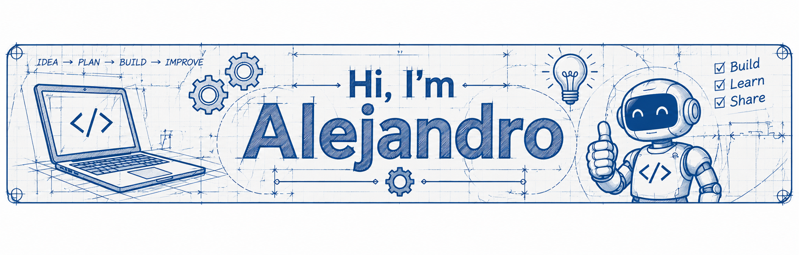

  

## 💫 &nbsp;About me
- 📖 Studying DAM 📖
- 🌱 I’m currently learning Java 🌱
- 🇬🇧 Improving my English skills 🇬🇧
- 🇨🇳 Learning Chinese 🇨🇳
- ⚡ Future Software Engineer ⚡
 

## 💻 Tech Stack
 
    

 
 

# 📊 GitHub Stats:
 
 

---

<!--

**AlejandroEleazar/AlejandroEleazar** is a ✨ _special_ ✨ repository because its `README.md` (this file) appears on your GitHub profile.

Here are some ideas to get you started:

- 🔭 I’m currently working on ...
- 🌱 I’m currently learning ...
- 👯 I’m looking to collaborate on ...
- 🤔 I’m looking for help with ...  
- 💬 Ask me about ...
- 📫 How to reach me: ...
- 😄 Pronouns: ...
- ⚡ Fun fact:...

-->
